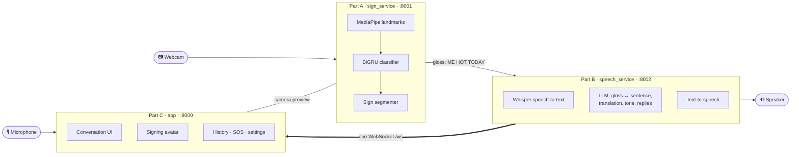

# SignBridge: Two-Way Communication Assistant

**A real-time conversation assistant between a Deaf person who signs Indian Sign Language (ISL) and a hearing
person who speaks English, Hindi or Telugu.**

The Deaf person signs to a webcam, and SignBridge turns the signs into a natural sentence spoken aloud in the hearing
person's language. The hearing person speaks, and SignBridge shows their words as captions with a tone tag and plays
them back in ISL through an on-screen signing avatar. Quick replies, a phrase board and an emergency SOS mode cover
the moments when signing isn't practical.

Most accessibility apps only work one way (speech → captions), which leaves the Deaf user typing replies. SignBridge
works **both ways**, is built for **ISL and Indian languages**, and carries **tone and urgency** across the gap.

---

## Contents

- [Features](#features)
- [How it works](#how-it-works)
- [Quick start](#quick-start)
- [Using SignBridge](#using-signbridge)
- [Results](#results)
- [Message format](#message-format)
- [Project structure](#project-structure)
- [Tech stack](#tech-stack)
- [Team](#team)
- [Limitations and future work](#limitations-and-future-work)
- [Credits and licence](#credits-and-licence)

---

## Features

| | Feature | What it does |
|---|---|---|
| ✋ | **ISL sign recognition** | Recognises 17 ISL signs from a normal laptop webcam (MediaPipe landmarks + BiGRU), including continuous signing |
| 💬 | **Signs → sentence** | An LLM turns ISL gloss (`ME HOT YESTERDAY TODAY`) into a natural sentence ("I've had a fever since yesterday.") |
| 🗣️ | **Multilingual speech** | Speech-to-text and text-to-speech in **English, Hindi and Telugu**, with live captions while the person talks |
| 🧏 | **Signing avatar** | Plays the hearing person's words back as ISL sign clips, or as a 2-D figure drawn from sign landmarks |
| 🎭 | **Tone tags** | Every caption is tagged 😊 happy, 😠 angry, ⚠️ urgent, ❓ question or 💬 neutral. Urgent speech flashes the screen |
| ⚡ | **Smart quick replies** | Four context-aware reply suggestions after each thing the hearing person says, answered in one tap |
| 📋 | **Phrase board** | Common phrases ready to tap, plus the user's own custom phrases |
| 🆘 | **Emergency SOS** | One tap: a flashing full-screen emergency message in the listener's language, large preset phrases, location on screen |
| ♿ | **Accessibility** | Large text, high contrast, flash and vibration alerts, keyboard friendly, works on phones and tablets |
| 🗂️ | **Summary and history** | Saves each conversation with an AI summary. Export to text, JSON or PDF (useful at a doctor's visit) |
| 📚 | **Learn as you talk** | After a conversation, shows the signs used most so the hearing person can learn them |

---

## How it works

SignBridge is three services that talk over WebSockets using one shared JSON message format.



1. **Signer → hearing person.** Part A reads the webcam, recognises each sign and sends a gloss sequence. Part B turns
   it into a natural sentence in the listener's language. Part C shows it and reads it aloud.
2. **Hearing person → signer.** Part C records speech (or takes typed text). Part B transcribes it, tags the tone, picks
   the ISL signs for the avatar and suggests replies. Part C shows the caption and plays the signs.
3. **Routing.** Part B is the hub: it connects to Part A and forwards its messages, so the app needs only one WebSocket.

If no AI provider is available, Part B falls back to a local Ollama model and then to built-in rules, so the
conversation keeps working offline (with simpler sentences).

---

## Quick start

### Requirements

- Windows, macOS or Linux with a webcam and microphone
- **Python 3.11+**, **Node.js 20+**, **Docker Desktop** (for Part B)
- **Chrome or Edge** (for the browser's speech recognition)
- A free **Groq API key** from https://console.groq.com/keys (optional, but gives much better sentences and Telugu
  speech recognition)

### 1. Set up each part (first time only)

```powershell
git clone https://github.com/Varshithaprabha/Speech_Processing_Recognition.git
cd Speech_Processing_Recognition
```

**Part A: sign recognition**

```powershell
cd sign_service
pip install -r requirements.txt
python scripts/fetch_include.py     # downloads only the needed INCLUDE videos (~1 h, resumable)
python scripts/train.py             # trains the sign classifier -> models/sign_classifier.pt
cd ..
```

Skip the download and training if you only want to try the app: use `python service.py --mock` below.

**Part B: speech and AI**

```powershell
cd speech_service
copy .env.example .env              # then open .env and paste your key after GROQ_API_KEY=
cd ..
```

> ⚠️ Put your key only in `.env` (ignored by git), **never** in `.env.example`.

**Part C: the app**

```powershell
cd app
python -m venv .venv
.venv\Scripts\pip install -r requirements.txt
cd web
npm install
npm run build
cd ..\..
```

On macOS/Linux use `.venv/bin/pip` and `.venv/bin/python`.

### 2. Run it

Open Docker Desktop first, then run each part in its own terminal:

```powershell
cd sign_service; python service.py                 # Part A on :8001  (add --mock to run without a camera)
```
```powershell
cd speech_service; docker compose up -d --build    # Part B on :8002  (logs: docker compose logs -f)
```
```powershell
cd app; .venv\Scripts\python server.py             # Part C on :8000
```

Open **http://localhost:8000**. The header shows a green **Speech** and **Camera** pill and **AI: groq** when
everything is connected.

### Try the app on its own

No camera, Docker or API key needed:

```powershell
cd app; .venv\Scripts\python server.py --mock
```

Then open **http://localhost:8000/?mock**. A built-in mock plays the role of Parts A and B.

### Stop

```powershell
cd speech_service; docker compose down
```

Press `Ctrl+C` in the Part A and Part C terminals.

---

## Using SignBridge

The screen is split in three: the **Deaf user** on the left, the **conversation** in the middle, the **hearing
person** on the right. On a phone they become tabs.

**Hearing person (right side)**
- Choose **English / हिन्दी / తెలుగు**, tap 🎙️ and speak, or switch to **Type**.
- The Deaf user's signs appear here as a sentence and are read aloud. Tap 🔊 to hear it again.

**Deaf user (left side)**
- The avatar signs what the hearing person said, with the caption and tone tag underneath. A **?** means the speech was
  unclear. Tap **Ask them to repeat**.
- Reply in one of three ways:
  - **Sign**: sign to the camera and drop your hands briefly between signs. Lower them for ~1.5 s (or tap
    **Send signs**) to finish the sentence.
  - **Tap**: a quick-reply chip, a phrase from the board, or one of **My phrases** (edit with ✏️).
  - **Type**: the message is spoken aloud.

**Header**
- 🆘 **SOS**: emergency mode.
- 💾 **End & save**: saves the conversation with a summary.
- 🗂 **History**: past conversations, export, and signs to practise.
- ⚙️ **Settings**: text size, high contrast, alerts, avatar style and speed, voice, speech recognition
  (Browser or Whisper; Whisper is better for Telugu), service addresses.

### Demo scenario: hospital reception

1. The receptionist speaks Telugu: *"దయచేసి వెంటనే డాక్టర్ దగ్గరకు వెళ్ళండి"*. The patient sees
   "Please go to the doctor immediately." tagged ⚠️ **Urgent**, and the avatar signs **DOCTOR**.
2. The patient signs **ME HOT YESTERDAY TODAY**. The app says in Telugu *"నిన్నటి నుండి నాకు జ్వరం ఉంది"*
   ("I've had a fever since yesterday.").
3. The patient taps **Please call my family**.
4. **End & save** stores the conversation with its summary.

### Sign vocabulary

HELLO · HOW-ARE-YOU · THANK-YOU · ME · YOU* · DOCTOR · HOSPITAL · SICK · HOT (fever) · GOOD · BAD · MEDICINE · TODAY ·
TOMORROW · YESTERDAY · MOTHER · FATHER · FAMILY

\*YOU is played by the avatar but not recognised from the camera (the camera can't reliably tell it apart from ME).

---

## Results

**Sign recognition (Part A)**, 17 signs, INCLUDE videos + webcam clips recorded by the team:

| Test set | Clips | Accuracy |
|---|---|---|
| All test clips | 83 | **98.8 %** |
| INCLUDE studio videos | 46 | 97.8 % |
| Team webcam clips | 37 | 100 % |
| Held-out signer (a person the model never saw, 18 signs) | 138 | 97.1 % |

Confusion matrices are in [`sign_service/reports/`](sign_service/reports/).

**Speed (Part B, Docker on a laptop, Groq free tier)**

| Step | Time |
|---|---|
| Speech → caption + tone + avatar signs | 1.3 – 2.5 s |
| Live partial caption | ~0.5 s |
| Signs → sentence | 0.5 – 1.2 s |
| Text-to-speech | ~1.5 s per sentence |

---

## Message format

Every part sends and receives the same JSON shape (section 6 of the project plan):

```json
{
  "from": "signer",
  "type": "gloss",
  "content": "ME HOT YESTERDAY TODAY",
  "sentence": "I've had a fever since yesterday.",
  "language": "en",
  "emotion": "neutral",
  "confidence": 0.89,
  "timestamp": "2026-11-24T10:15:02+05:30"
}
```

| Field | Values |
|---|---|
| `from` | `signer`, `speaker`, `system` |
| `type` | `gloss`, `gloss_partial`, `text`, `speech_partial`, `alert`, `suggestions`, `summary`, `status` |
| `language` | `en`, `hi`, `te` |
| `emotion` | `neutral`, `happy`, `angry`, `urgent`, `question` |

The full list of messages and commands is in [`speech_service/README.md`](speech_service/README.md).

---

## Project structure

```
Speech_Processing_Recognition/
├── sign_service/          Part A: vision & sign recognition (FastAPI, port 8001)
│   ├── service.py           WebSocket service + camera preview
│   ├── signbridge_sign/     landmarks, features, model, recogniser
│   ├── scripts/             download INCLUDE, record webcam signs, train, live demo
│   ├── clips/               one short video + landmark file per sign (for the avatar)
│   └── reports/             accuracy and confusion matrices
├── speech_service/        Part B: speech, language & AI (FastAPI in Docker, port 8002)
│   ├── service.py           message hub, speech-to-text, text-to-speech endpoints
│   ├── signbridge_speech/   ASR, LLM prompts, rules fallback, TTS, pipeline
│   └── docker-compose.yml
└── app/                   Part C: app, avatar & integration (port 8000)
    ├── server.py            serves the app, sign clips, history and phrases
    ├── mock_hub.py          stand-in for Parts A + B
    └── web/                 React + Tailwind front end
```

Each part has its own README with details, and a REPORT section for the project report:

| Part | Folder | Owner | Docs |
|---|---|---|---|
| A: Vision & Sign Recognition | [`sign_service/`](sign_service/) | Varsh | [README](sign_service/README.md) |
| B: Speech, Language & AI | [`speech_service/`](speech_service/) | Roshni | [README](speech_service/README.md) · [Report](speech_service/REPORT.md) |
| C: App, Avatar & Integration | [`app/`](app/) | Indrasena Reddy | [README](app/README.md) · [Report](app/REPORT.md) |

---

## Tech stack

| Area | Tools |
|---|---|
| Sign recognition | MediaPipe Holistic, PyTorch (BiGRU + attention), OpenCV |
| Speech-to-text | Groq Whisper large-v3, local faster-whisper, browser Web Speech API |
| Language and AI | Groq (`gpt-oss-120b`), Ollama (`gemma3:4b`) offline fallback, rule-based fallback |
| Text-to-speech | edge-tts (en-IN, hi-IN, te-IN voices), browser speechSynthesis |
| Backend | Python, FastAPI, WebSockets, SQLite, Docker |
| Front end | React, Vite, Tailwind CSS |
| Data | INCLUDE ISL dataset (AI4Bharat) + webcam clips recorded by the team |

---

## Team

| Member | Part |
|---|---|
| **Varsh** | A: Vision & Sign Recognition |
| **Roshni** | B: Speech, Language & AI |
| **Indrasena Reddy** | C: App, Avatar & Integration |

---

## Limitations and future work

- **Vocabulary**: 17 recognised signs, chosen for a hospital conversation. No fingerspelling yet.
- **Real-world testing**: speech was tested with generated voices and signing with the team. It still needs
  testing with Deaf ISL users, real accents and background noise.
- **Tone** is read from the words, not from the voice or the signer's face.
- Messages the Deaf user **types** are spoken in English only (not translated yet).
- **Future work:** fingerspelling, facial-expression emotion, emotion-matched voice, sound alerts (doorbell, alarm),
  personal sign training, a 3-D avatar, offline mode and a mobile app.

---

## Credits and licence

Sign data comes from the **INCLUDE** dataset by AI4Bharat (IIT Madras), licensed
**CC BY-NC-SA 4.0**, and is used here for non-commercial academic work.

> A. Sridhar, R. G. Ganesan, P. Kumar, M. Khapra. "INCLUDE: A Large Scale Dataset for Indian Sign Language
> Recognition." *ACM Multimedia*, 2020.

This is a college project. Because it uses INCLUDE, it must not be used commercially.
