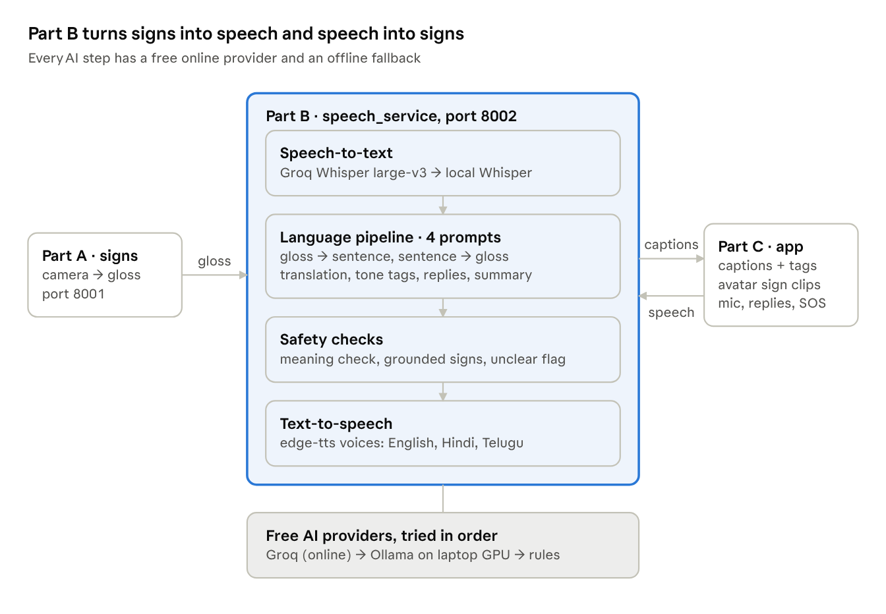

# SignBridge — Part B: Speech, Language & AI

Nov 24, 2026 · Roshni

Part B turns the hearing person's speech in English, Hindi or Telugu into captions, tone tags and ISL sign sequences, and turns the Deaf person's signed gloss into natural spoken sentences. It runs as one service (`speech_service`, port 8002) and uses only free AI providers, with offline fallbacks.

## 1. Role and scope

Part B owns everything to do with voice and language in SignBridge. It sits between Part A (sign recognition, which produces ISL gloss) and Part C (the app, which shows captions and plays the signing avatar).

The project document lists these Part B responsibilities. All core items are implemented; three were moved to future work by the team's 4-day sprint plan.

| Responsibility (project doc, section 5) | Status |
| --- | --- |
| Speech-to-text in English, Hindi and Telugu | Done |
| Streaming partial (live) captions | Done |
| Tone/emotion tag on the speaker's words | Done, read from the text (as the sprint plan specifies) |
| Text-to-speech in the three languages | Done |
| ISL gloss → natural sentence | Done |
| Sentence → ISL gloss for the avatar | Done |
| Translation between English, Hindi and Telugu | Done |
| Smart quick replies from the last few messages | Done |
| Conversation auto-summary (stretch) | Done |
| Tone from voice audio (pitch/energy) | Future work (cut in sprint plan) |
| TTS voice style matched to the signer's expression | Future work (cut in sprint plan) |
| Sound-awareness alerts (stretch) | Future work (cut in sprint plan) |

The project document asks for a `speech_service` and a `language_service`. Both are delivered as one FastAPI process, which keeps the WebSocket connection to Part C simple; the two roles stay separate inside the code.

## 2. Architecture

Part A sends signed gloss to Part B; Part B sends captions, sentences, avatar sign lists and reply suggestions to the app (Part C), and receives the speaker's speech and the patient's taps back. Inside Part B, speech-to-text feeds the language pipeline, every AI answer passes the safety checks, and signed sentences are then spoken aloud.

## 3. Implementation

The service is written in Python with FastAPI and WebSockets. Every feature uses the best available provider first and falls back to a simpler one, so the demo keeps working without internet.

### 3.1 Speech-to-text

Speech is transcribed by Whisper large-v3, hosted free by Groq; it is much more accurate for Hindi and Telugu than smaller models. When Groq is unreachable or over its free limit, a local Whisper model (`small`, via faster-whisper) takes over. The service accepts any audio format a browser or phone records (WebM, Ogg, MP3, M4A, WAV) and converts it to 16 kHz mono before transcription.

### 3.2 Live partial captions

While the hearing person is still speaking, partial captions are sent as `speech_partial` messages. They come either from the browser's own speech recognition or from the faster Whisper large-v3-turbo model on audio recorded so far (about 0.5 s per update). Partial captions skip the AI step so they appear instantly.

### 3.3 Language pipeline

Four prompts to a large language model (gpt-oss-120b on Groq, with Gemma 3 4B on a local Ollama server as fallback) do the language work. Each returns strict JSON, so the output can always be parsed.

1. **Gloss → sentence.** ISL gloss such as `ME HOT YESTERDAY TODAY` becomes "I've had a fever since yesterday." The prompt explains ISL grammar (time words first, no articles, "YESTERDAY TODAY" = since yesterday) and uses the last few messages to resolve short answers. The sentence is produced in the hearing person's language.
2. **Sentence → gloss.** The hearing person's words become a short ISL-ordered sign sequence (greeting, time, subject, rest), using only the 18 signs that have avatar clips. Each sign is sent with its video file so the app can play them in order.
3. **Smart quick replies.** After each thing the hearing person says, four short replies are suggested for the Deaf user to tap (for "Did you take your medicine?": "Yes, I took it." / "No, I didn't take it."), in the hearing person's language.
4. **Summary.** At the end, the conversation becomes a short record with key points (symptoms, medicines, instructions), plus the full transcript for export.

### 3.4 Tone tags

Each caption carries one of five tags from the shared message format: neutral, happy, angry, urgent or question. As the sprint plan specifies, tone is read from the words, not the audio. The language model assigns the tag, and keyword rules override it so urgency ("immediately", "emergency") and anger (shouting in capitals, "!!") are never missed.

### 3.5 Text-to-speech

The Deaf user's sentences are spoken with Indian English, Hindi and Telugu neural voices through edge-tts, slightly faster when the message is urgent. The app can use the browser's built-in speech synthesis instead.

### 3.6 Phrase board and SOS

Eleven fixed phrases ("Please write it down for me", "Please call my family") and an emergency message are stored in all three languages, so they work even with no AI available.

## 4. Safety: keeping the AI faithful

In a hospital, a wrong caption or an invented symptom is worse than a clumsy one. During testing the smaller local model did invent content (it turned `MEDICINE GOOD` into "I need a doctor urgently!"), so Part B checks every AI answer against what was actually signed or said.

- **A grammar draft anchors the meaning.** A rule-based converter first writes a plain draft of the signed sentence. The AI receives it as the meaning to keep and may only make it sound more natural.
- **Meaning check on signed sentences.** The service extracts the concepts the AI's sentence mentions (fever, medicine, family…). If any was not signed, it retries once without conversation history, then falls back to the draft. The patient is never misquoted.
- **Captions come only from what was said.** The speaker-side prompt receives no conversation history, so it cannot fill gaps with earlier topics. When speech-to-text output is garbled, the message is marked `unclear` instead of guessed, and the app can show "?" so the patient asks the speaker to repeat.
- **Avatar signs are grounded.** Each sign the AI chooses must match a word in what was said (in the original language or the English caption); signs it missed are added back.
- **The signer's emotion is kept.** Part A reads emotion from the signer's face; the AI may only upgrade "neutral" to "question", never change it otherwise.
- **Emergencies are never downgraded.** Urgent and angry wording detected by rules always overrides a calmer AI tag.

## 5. Interface

All messages follow the team's shared JSON format (project doc, section 6): `from`, `type`, `content`, `sentence`, `language`, `emotion`, `confidence` and `timestamp`. Part C opens a single WebSocket to Part B (`ws://localhost:8002/ws`); Part B relays Part A's messages, so the app needs no second connection.

| From | Type | `content` | `sentence` | Extra fields |
| --- | --- | --- | --- | --- |
| signer | `gloss` | `ME HOT YESTERDAY TODAY` | "I've had a fever since yesterday." (speaker's language) | `sentence_en`, `source` |
| signer | `text` | tapped phrase (English) | phrase in speaker's language | `kind`: quick_reply / suggestion |
| signer | `alert` | `SOS` | emergency message | emotion `urgent` |
| speaker | `speech_partial` | words so far | same | — |
| speaker | `text` | words as said (original language) | English caption | `gloss`, `clips`, `unclear` |
| system | `suggestions` | — | — | four replies, ids s1–s4 |
| system | `summary` | summary | summary | `key_points`, `transcript` |

The app sends JSON commands on the same socket: `text` and `partial` (speaker's words), `quick_reply`, `sos`, `summary` and `set_language`. Audio can also be posted to `/speech` and `/speech_partial`, and `/tts` returns spoken audio. `suggestions` and `summary` are additions to section 6, in the same way Part A added `gloss_partial` and `status`.

## 6. Deployment

Part B runs in a Docker container on port 8002 and costs nothing to operate. Each provider falls back to the next automatically, and every message records which one answered in its `source` field.

| Task | 1st choice | Fallback | Last resort |
| --- | --- | --- | --- |
| Speech-to-text | Groq Whisper large-v3 (free, online) | Local Whisper `small` (offline) | Browser speech recognition, sent as text |
| Language (4 prompts) | Groq gpt-oss-120b (free, online) | Ollama Gemma 3 4B on the laptop GPU (offline) | Built-in rules and templates |
| Text-to-speech | edge-tts neural voices (online) | Browser speech synthesis | — |

Docker was needed because Windows Smart App Control on the development laptop blocks the native libraries that Whisper and PyTorch load. Inside a Linux container the policy does not apply, so the security setting could stay on. The container reaches Part A and Ollama on the host through `host.docker.internal`, and reads the avatar clip index from Part A's folder read-only.

The only secret is a free Groq API key, kept in a local `.env` file that Git ignores. Groq's free tier allows about 8,000 tokens per minute for the language model; low reasoning effort keeps each request small, and after a rate-limit error Groq is skipped for the wait time it requests.

## 7. Testing and results

The full two-way conversation worked end to end against Part A's mock signer, with every signed sentence, caption and avatar sign correct in the final run. Testing used a scripted client that plays the app's role: it sends speech, taps replies, triggers SOS and requests the summary.

| Test | Input | Output | Time |
| --- | --- | --- | --- |
| Gloss → sentence | `ME HOT YESTERDAY TODAY` | "I've had a fever since yesterday." | 0.5–1.2 s |
| Gloss → Telugu sentence | `DOCTOR TOMORROW` (question) | "డాక్టర్ రేపు వస్తారా?" (Will the doctor come tomorrow?) | 0.8 s |
| Telugu speech (demo scene) | "దయచేసి వెంటనే డాక్టర్ దగ్గరకు వెళ్ళండి" | "Go to the doctor immediately.", tag urgent | 2.5 s |
| Hindi speech | "क्या आपने आज दवा ली?" | "Did you take your medicine today?", signs TODAY YOU MEDICINE | 1.4 s |
| English speech | "Did you take your medicine yesterday?" | signs YESTERDAY YOU MEDICINE, tag question | 1.3 s |
| Live partial caption | Telugu audio in progress | partial text | 0.5 s |
| Smart replies | Telugu fever question | 4 replies in Telugu, incl. "Yes, I have a fever" / "No" | after caption |
| Angry tone | "WHY ARE YOU LATE FOR YOUR APPOINTMENT AGAIN" | tag angry | — |
| Garbled speech | Telugu misheard by the small offline model | marked `unclear`, no invented meaning | — |
| Text-to-speech | sentences in te, hi, en | MP3 audio | ~1.5 s |

Times are for the full step (speech → text → caption, tone and signs), measured in Docker on a laptop using Groq's free tier.

Not yet tested: all speech was generated by text-to-speech voices rather than recorded from people, so accuracy with real speakers, accents and background noise is still unmeasured. Integration with Part A's trained sign model is planned for the team's integration day; until then Part A's mock was used.

## 8. Challenges and solutions

| Challenge | Solution |
| --- | --- |
| Windows Smart App Control blocked Whisper's and PyTorch's native libraries on the development laptop | Ran Part B in a Linux Docker container instead of turning the security feature off |
| A paid LLM API was not an option for the team | Free Groq API first, local Ollama model second, rule-based templates last |
| The small local model invented content (`MEDICINE GOOD` → "I need a doctor urgently!") | Rule-based draft as the meaning to keep, concept check on the AI's sentence, retry without history, then fall back to the draft |
| Garbled Telugu transcription led the AI to invent an unrelated caption from earlier conversation | Removed history from the speaker prompt and added the `unclear` flag; switched to Whisper large-v3, which transcribed the same line correctly |
| Groq's free tier hit its limit of 8,000 tokens per minute once smart replies doubled the number of calls | Low reasoning effort (thinking tokens per call fell from 170 to 12), plus a cooldown that skips Groq after a rate-limit error |
| MP3 and WebM audio failed because the installed audio library was newer than faster-whisper expected | Part B decodes all audio itself with PyAV and passes raw samples to Whisper |
| Shouting was lost once the caption was cleaned up (CAPS → normal case) | Tone rules check the original words as well as the caption |
| ISL gloss "YOU" was dropped by Part A's recogniser because it was confused with "ME" | The avatar still uses the YOU clip on the speaker side; the signer-side prompts list only the 17 recognised signs |

## 9. Limitations and future work

**Limitations**

- Accuracy with real speakers is unmeasured: tests used synthetic voices in a quiet setting, with no background noise.
- The avatar can sign only the 18 words that have clips; other words appear only in the caption.
- Best quality needs internet. Offline, Telugu speech recognition and Telugu sentences are noticeably weaker.
- Smart replies may occasionally include a detail the patient has not mentioned (e.g. "fever and chills"). They are only options the patient chooses from, but should be reviewed with real users.
- The free Groq tier limits requests per minute and per day, so a long or busy session may fall back to the local model.

**Future work**

- Detect tone from the voice itself (pitch and energy features, or a pretrained speech-emotion model) rather than only from the words.
- Match the text-to-speech voice style to the signer's facial expression, once Part A adds expression detection.
- Sound-awareness alerts (doorbell, alarm, someone calling the user's name) using a sound classifier such as YAMNet.
- Evaluate with Deaf ISL users and hospital staff, measuring word error rate per language and caption accuracy.
- Fully offline mode with larger local models, for hospitals and rural areas without reliable internet.

## 10. References

1. A. Radford, J. W. Kim, T. Xu, G. Brockman, C. McLeavey and I. Sutskever, "Robust Speech Recognition via Large-Scale Weak Supervision," ICML 2023. [arXiv:2212.04356](https://arxiv.org/abs/2212.04356)
2. A. Sridhar, R. G. Ganesan, P. Kumar and M. Khapra, "INCLUDE: A Large Scale Dataset for Indian Sign Language Recognition," ACM Multimedia 2020. [doi:10.1145/3394171.3413528](https://doi.org/10.1145/3394171.3413528)
3. OpenAI, "gpt-oss-120b & gpt-oss-20b Model Card," 2025. [arXiv:2508.10925](https://arxiv.org/abs/2508.10925)
4. Gemma Team, Google DeepMind, "Gemma 3 Technical Report," 2025. [arXiv:2503.19786](https://arxiv.org/abs/2503.19786)
5. Groq, "Supported models" (Whisper large-v3, gpt-oss-120b). [console.groq.com/docs/models](https://console.groq.com/docs/models)
6. SYSTRAN, faster-whisper. [github.com/SYSTRAN/faster-whisper](https://github.com/SYSTRAN/faster-whisper)
7. Ollama. [ollama.com](https://ollama.com)
8. edge-tts. [github.com/rany2/edge-tts](https://github.com/rany2/edge-tts)
9. FastAPI. [fastapi.tiangolo.com](https://fastapi.tiangolo.com)
10. SignBridge source code, `speech_service/`. [github.com/Varshithaprabha/Speech_Processing_Recognition](https://github.com/Varshithaprabha/Speech_Processing_Recognition)
